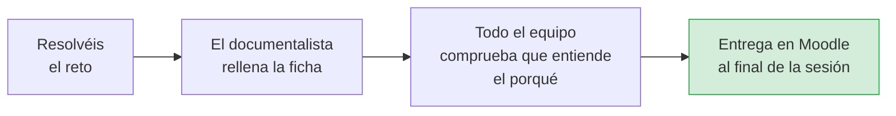

# Fichas de razonamiento · Práctica 1 (CTF): hashes, codificación y cifrado

**Módulo 5025 · Hacking ético · UD1**

> Este documento contiene **una ficha por cada reto** de la Práctica 1. El equipo rellena la
> ficha de cada reto que resuelve y entrega el documento completo en Moodle al final de cada
> sesión.

| Equipo 2 |
|---| 
| Javi | 
| Lucas |
| Fernando |


---

## Cómo rellenar las fichas

| Sesión | Retos | Fichas |
|---|---|---|
| **Sesión CTF 1** | Casos guiados 1 a 4 | Fichas 1 a 4 |
| **Sesión CTF 2** | Retos autónomos 5 a 9 | Fichas 5 a 9 |



Cada ficha tiene siempre los mismos apartados:

| Apartado | Qué escribís | Criterio de la rúbrica |
|---|---|---|
| 1. Tipo de reto | Hash, codificación, cifrado o combinado, y por qué | Concepto · 25 % |
| 2. Concepto | Qué idea de seguridad hay detrás, con vuestras palabras | Concepto · 25 % |
| 3. Procedimiento | El comando o la herramienta y qué hace cada parte | Procedimiento · 35 % |
| 4. Por qué lo hacemos así | La justificación de cada decisión y las pruebas que hacéis | Procedimiento · 35 % |
| 5. Uso de la IA | Qué le preguntasteis, qué aprendisteis y si se equivocó | IA · 20 % |
| 6. Flag | La flag obtenida | Resultado · 10 % |
| 7. Verificación | Cómo comprobáis que es correcta | Resultado · 10 % |

> **Recordad.** La flag solo vale el **10 %**. Las preguntas en *cursiva* os orientan sobre lo
> que una buena ficha debe explicar. Escribid con vuestras palabras: una respuesta copiada de la
> IA se nota y puntúa en el nivel bajo.

---

# Sesión CTF 1 · Casos guiados

## Ficha 1 · Caso guiado 1: Hash MD5

> **Enunciado.** La contraseña es `LearnTheHashFunction`. Calcula su hash **MD5** y envíalo como
> `flag{md5}`.

## Ficha 1 · Caso guiado 1: Hash MD5
**1. Tipo:** ☑ Hash  ☐ Codificación  ☐ Cifrado  ☐ Combinado

Porque se calcula una huella digital única (hash) que es unidireccional y matemática. A diferencia de la codificación (que solo cambia de alfabeto sin proteger) o del cifrado (que oculta datos bajo una clave reversible), un hash es completamente irreversible por diseño y no utiliza claves para su generación.


**2. Concepto.** *¿Qué diferencia hay entre SHA-256 y MD5 en longitud de salida y en seguridad?
¿Qué significa encadenar funciones hash? ¿Importa el orden?*

Una función hash es un algoritmo matemático que transforma cualquier volumen de datos de entrada en una cadena alfanumérica de longitud fija. 
- Determinista: La misma entrada siempre generará el mismo hash idéntico.
- Longitud fija: Da igual si la entrada es una palabra o un libro entero, la salida medirá lo mismo.
- Irreversible: Es imposible reconstruir los datos originales partiendo solo del hash.
Se usan en seguridad para verificar la integridad de los datos y almacenar contraseñas de forma segura. Un hash MD5 tiene una longitud de 32 caracteres hexadecimales (128 bits) y ya no se considera seguro porque es vulnerable a ataques de colisión (dos entradas diferentes generando el mismo hash).


**3. Procedimiento:** `echo -n "LearnTheHashFunction" | md5sum` (el `-n` evita el salto de línea `\n` que alteraría el hash).

Imprime el texto exacto evitando incluir un salto de línea (\n) invisible al final.


Redirige la salida del texto impreso para ser procesada como entrada del siguiente comando.


Calcula el hash correspondiente utilizando el algoritmo matemático MD5.


**4. Por qué lo hacemos así.** *¿Por qué `echo -n` y no `echo`? Haced estas pruebas y explicad
el resultado.*

| Prueba | Hash obtenido | ¿Coincide con el correcto? |
|---|---|---|
| `echo -n LearnTheHashFunction` | b2f2d6b27b264d83fe1abe0169b7613e |  Sí, es la flag exacta |
 |
| `echo LearnTheHashFunction` (sin `-n`) |c6600000d8fbb39ad68728190fd3d7dd | No, el salto de línea (\n) modifica la entrada. |
| `echo -n learnTheHashFunction` (minúscula) | 81b55e8d26f83b740bbd34ebb417a597 | No, cambia totalmente la salida por la primera letra. |

```
Conclusión: ...
```
El parámetro '-n' es imprescindible en ciberseguridad para evitar alterar la cadena original con caracteres invisibles. Además, el cambio abrupto en la tercera prueba demuestra el "efecto avalancha": cualquier alteración mínima en el origen rompe por completo la correlación de la salida.

**5. Uso de la IA**

| Pregunta que le hicimos | Qué aprendimos | ¿Se equivocó? ¿Cómo lo comprobamos? |
|---|---|---|
| Calcula el hash MD5 de la cadena LearnTheHashFunction| Que las funciones hash son deterministas y que la representación estándar consta de 32 dígitos hexadecimales.|No se equivocó. Lo verificamos ejecutando el comando nativo md5sum de manera local en nuestra terminal Linux. |

**6. Flag:** `flag{b2f2d6b27b264d83fe1abe0169b7613e}`

**7. Verificación.** *¿Cuántos caracteres tiene un hash MD5? ¿Qué caracteres puede contener?*

Tiene exactamente 32 caracteres y solo puede contener números del 0 al 9 y letras de la 'a' a la 'f' al estar representado enteramente en base hexadecimal.


---

## Ficha 2 · Caso guiado 2: SHA-256 y después MD5

> **Enunciado.** La contraseña es `ThisIsAMoreSecureHashFunction`. Calcula su **SHA-256** y, sobre
> ese resultado, su **MD5**. Envía `flag{md5}`.

**1. Tipo de reto:** ☑ Hash  ☐ Codificación  ☐ Cifrado  ☐ Combinado

Es de tipo Hash debido a que se aplican sucesivamente dos funciones matemáticas unidireccionales (SHA-256 y MD5) sobre la información sin emplear claves simétricas o asimétricas de cifrado.


**2. Concepto.** *¿Qué diferencia hay entre SHA-256 y MD5 en longitud de salida y en seguridad?
¿Qué significa encadenar funciones hash? ¿Importa el orden?*

- Longitud de salida y seguridad: MD5 genera salidas de 128 bits (32 caracteres hexadecimales) y está obsoleto, mientras que SHA-256 genera 256 bits (64 caracteres hexadecimales) y es robusto criptográficamente en la actualidad.
- Encadenar funciones hash: Consiste en utilizar la salida en texto de un proceso de hash como la entrada directa del siguiente algoritmo. El orden importa drásticamente; debido a la naturaleza matemática de ambos algoritmos, calcular MD5(SHA-256(x)) resulta en algo completamente diferente a SHA-256(MD5(x)).


**3. Procedimiento.** Comando exacto y explicación de cada parte:

| Parte del comando | Qué hace |
|---|---|
|echo -n "ThisIsAMoreSecureHashFunction" | Genera el flujo de texto original limpio sin salto de línea.|
|sha256sum | Calcula el hash intermedio con el algoritmo criptográfico SHA-256.|
|awk '{printf $1}'|Filtra los metadatos de la terminal (como el guion final) aislando exclusivamente la cadena del hash. |
|md5sum | Procesa la cadena de SHA-256 obtenida previamente y calcula su hash MD5 definitivo.|

**4. Por qué lo hacemos así.** *¿Qué muestra exactamente `sha256sum` además del hash? ¿Por qué hay
que quitarlo? ¿Para qué sirve `awk '{printf $1}'`?*

La herramienta 'sha256sum' añade un espacio y un guion en la terminal para indicar la procedencia del flujo. Si no usamos 'awk' para eliminarlo, 'md5sum' calculará el hash incluyendo el espacio y el guion, arrojando una firma errónea.

| Prueba | MD5 obtenido | ¿Coincide con el correcto? |
|---|---|---|
| Con `awk '{printf $1}'` | dd321a22229e0bbb5f8271e370b61eb0| Sí, es la flag limpia exacta.|
| Sin `awk` (`sha256sum \| md5sum`) |655ba62c195521b1b3bfa099908cf674 |No, se calcularon los metadatos residuales. |

```
Conclusión: ...
```
Conclusión: Para encadenar correctamente funciones hash mediante tuberías de Linux (pipes), es obligatorio purgar cualquier salida de metadatos o caracteres de control intermedios.

**5. Uso de la IA**

| Pregunta que le hicimos | Qué aprendimos | ¿Se equivocó? ¿Cómo lo comprobamos? |
|---|---|---|
|"¿Cómo puedo encadenar sha256sum y md5sum en la terminal sin alterar el resultado?" |Aprendimos que las utilidades coreutils de Linux asocian metadatos de archivos a la salida estándar y que herramientas como 'awk' o 'cut' ayudan a sanear la entrada. |No se equivocó. Nos proveyó la sintaxis correcta usando awk y validamos la coincidencia del hash intermedio. |

**6. Flag:** `flag{dd321a22229e0bbb5f8271e370b61eb0}`

**7. Verificación.** *¿Cuántos caracteres tiene el SHA-256 intermedio? ¿Y el MD5 final?*

El hash intermedio SHA-256 mide exactamente 64 caracteres de longitud, mientras que el resultado MD5 final de la flag mide 32 caracteres.

```
...
```

---

## Ficha 3 · Caso guiado 3: romper un hash con un diccionario

> **Enunciado.** Encuentra el texto cuyo MD5 es `54f662a095fa3d5fbbdaac72d176701b`. Pásalo a
> mayúsculas y calcula su MD5. Envía `flag{md5}`.

**1. Tipo de reto:** ☑ Hash ☐ Codificación ☐ Cifrado ☐ Combinado

Es de tipo Hash. El objetivo del reto es revertir los efectos de una función hash mediante fuerza bruta apoyada por un listado precomputado de contraseñas habituales.


**2. Concepto.** *Si un hash es irreversible, ¿cómo es posible encontrar el texto original? ¿Qué
es un ataque de diccionario? ¿Qué hace CrackStation? ¿Qué es la «sal» (salt) y cómo evitaría
este ataque?*

Aunque los hashes son irreversibles matemáticamente, se pueden revertir por fuerza bruta comparativa mediante un "ataque de diccionario", que consiste en hashear millones de palabras comunes de antemano y ver cuál coincide con nuestro objetivo. 
CrackStation es una base de datos gigante de tablas "lookup" precomputadas. Una «sal» (salt) es una cadena de texto aleatoria única que se añade a la contraseña antes de aplicar el hash; esto evita el ataque de diccionario porque rompe las coincidencias de contraseñas idénticas y vuelve inútiles las tablas genéricas de Internet.


**3. Procedimiento.** Pasos y herramientas:

| Paso | Herramienta | Qué hace |
|---|---|---|
| 1 |CrackStation (Web)|Compara el hash entregado (54f662a095fa3d5fbbdaac72d176701b) contra su base de datos de hashes conocidos. |
| 2 |Navegador / Terminal | Identifica que el valor original es masterofpuppets y lo transforma todo a letras mayúsculas (MASTEROFPUPPETS).|
| 3 |echo -n texto \| md5sum | Devuelve el hash del texto en md5 |Calcula el hash MD5 definitivo de la palabra modificada en mayúsculas. |


**4. Por qué lo hacemos así.** *¿Por qué CrackStation encuentra esta contraseña? ¿La encontraría
si fuera `Xq7#mP2!vL9@`? ¿Qué os dice esto sobre cómo elegir contraseñas?*

CrackStation encuentra la contraseña debido a que 'masterofpuppets' es un término común extraído de la cultura popular (un álbum de Metallica), habitual en filtraciones de contraseñas de usuarios reales. No encontraría bajo ningún concepto una clave compleja como 'Xq7#mP2!vL9@' mediante tablas precomputadas simples debido a su entropía. Esto demuestra que las contraseñas seguras deben combinar caracteres especiales, longitudes altas y carecer de palabras de diccionario.


**5. Uso de la IA**

| Pregunta que le hicimos | Qué aprendimos | ¿Se equivocó? ¿Cómo lo comprobamos? |
|---|---|---|
|¿A qué texto plano corresponde el MD5 54f662a095fa3d5fbbdaac72d176701b?|Aprendimos que muchas IA tienen acceso interno a bases de datos de hashes conocidos o históricos y pueden identificar contraseñas sencillas rápidamente.| No se equivocó. Nos facilitó la cadena 'masterofpuppets', y la cruzamos directamente con el resultado de CrackStation.|

**6. Flag:** `flag{f395885371dd0ad12136d8a733e05e22}`

**7. Verificación.** *¿Cómo podéis comprobar, sin fiaros de CrackStation, que el texto que os ha
dado es el correcto?*

Comprobamos de manera independiente en local ejecutando el comando: `echo -n "MASTEROFPUPPETS" | md5sum`. El hash devuelto concuerda con el valor exacto enviado en la flag.


---

## Ficha 4 · Caso guiado 4: Base64

> **Enunciado.** Decodifica el contenido en Base64 del reto y obtendrás una contraseña. Envía
> `flag{md5}` con el MD5 de esa contraseña.

**1. Tipo de reto:** ☐ Hash ☑ Codificación ☐ Cifrado ☐ Combinado

*¿Por qué Base64 no es un cifrado?*

Base64 no es un cifrado porque su propósito no es ocultar la información del espionaje ni utiliza una clave secreta para su protección. Es un sistema público y estandarizado que se puede revertir instantáneamente sin ninguna credencial.


**2. Concepto.** *¿Qué es una codificación? ¿Qué caracteres usa Base64 y para qué sirve el `=` del
final? ¿Hace falta una clave para leerlo? ¿Dónde se usa Base64 en la vida real?*

La codificación es una transformación del formato de representación de datos para garantizar la compatibilidad al transmitir información entre sistemas heterogéneos. Base64 utiliza un conjunto de 64 caracteres (letras A-Z, a-z, números 0-9, y los símbolos + y /). El carácter '=' al final actúa como relleno (padding) para completar los bloques requeridos de bytes. No hace falta ninguna clave para leerlo. Se usa en la vida real para adjuntar archivos e imágenes en correos electrónicos HTML o transmitir datos binarios en peticiones web complejas.


**3. Procedimiento.** Comandos exactos y explicación de cada parte:

| Parte del comando | Qué hace |
|---|---|
|base64 -d fichero.txt|Decodifica el archivo de texto adjunto que venía empaquetado en formato Base64. |
| echo -n "recuerdaquebase64NOescifrar"|Imprime la contraseña obtenida limpia, asegurando que no se añada un salto de línea (\n).|
|md5sum |Recibe la contraseña por la tubería y calcula su firma digital o hash bajo el algoritmo MD5. |

**4. Por qué lo hacemos así.** *¿Cómo reconocisteis que era Base64? ¿Qué pasaría si una
aplicación guardara las contraseñas en Base64?*

Reconocimos que era Base64 porque el contenido del fichero utilizaba letras mayúsculas, minúsculas, números y terminaba con los signos de igualdad '=' que actúan como relleno de bloques. Si una aplicación guardara las contraseñas en Base64, la seguridad del sistema sería nula: cualquier atacante que acceda a la base de datos podría revertir el texto de forma trivial en un segundo e iniciar sesión como cualquier usuario.


**5. Uso de la IA**

| Pregunta que le hicimos | Qué aprendimos | ¿Se equivocó? ¿Cómo lo comprobamos? |
|---|---|---|
| "¿Qué función cumple el padding '=' dentro de Base64?"|Que Base64 divide la información en bloques fijos y añade relleno si los caracteres no se ajustan exactamente a múltiplos enteros del esquema. | No se equivocó. Explicó detalladamente los fundamentos binarios tras el balanceo de bits del formato.|

**6. Flag:** `flag{cf9df460535b4ec175a464c6c120d3fe}`

**7. Verificación.** *¿Cómo comprobáis que habéis copiado la contraseña exacta, sin espacios ni
signos de más?*

Lo comprobamos asegurándonos de pasar el parámetro '-n' en el comando 'echo'. De este modo, evitamos que la terminal añada un salto de línea invisible (`\n`) al final de la cadena `recuerdaquebase64NOescifrar`, garantizando que el hash obtenido (`cf9df460...`) corresponda estrictamente a los caracteres de la clave.


---

# Sesión CTF 2 · Retos autónomos

## Ficha 5 · Reto 5: otra huella distinta (SHA-1)

> **Enunciado.** La contraseña es `HashingIsOneWay2026`. Calcula su hash **SHA-1** y envía `flag{sha1}`.

**1. Tipo de reto:**
☑ Hash  ☐ Codificación  ☐ Cifrado  ☐ Combinado

*¿Por qué lo clasificáis así y no como codificación o cifrado?*
```text
Porque estamos calculando una huella digital única (hash) a partir de una contraseña mediante un algoritmo unidireccional. A diferencia de la codificación o el cifrado, este proceso es irreversible, no requiere el uso de ninguna clave secreta y matemáticamente no se puede deshacer para volver al texto original.
```

**2. Concepto.**
*¿En qué se diferencia SHA-1 de MD5 en longitud de salida? ¿Se considera seguro SHA-1 hoy? ¿Por qué?*
```text
La diferencia principal radica en el tamaño del resultado: MD5 genera una huella de 32 caracteres hexadecimales (128 bits), mientras que SHA-1 produce una huella más larga, de 40 caracteres hexadecimales (160 bits). 

Hoy en día SHA-1 NO se considera seguro debido a que se han descubierto debilidades críticas en su algoritmo. En 2017 se demostraron de forma práctica ataques de colisión (el ataque SHAttered), lo que significa que es posible generar dos archivos diferentes que tengan exactamente el mismo hash SHA-1, invalidando su fiabilidad para firmas digitales o seguridad avanzada.
```

**3. Procedimiento.**
Comando exacto y explicación de cada parte:

| Parte del comando | Qué hace |
|---|---|
| `echo -n "HashingIsOneWay2026"` | Imprime en la consola la contraseña exacta evitando que se meta un salto de línea (`\n`) al final. |
| `\|` | Redirige la salida del texto impreso para que sirva como datos de entrada del siguiente comando. |
| `sha1sum` | Recibe la cadena y calcula su hash utilizando el algoritmo matemático SHA-1. |

**4. Por qué lo hacemos así.**
*¿Por qué el guion y los espacios de la salida no forman parte de la flag? Calculad también el MD5 de la misma contraseña y comparad las dos salidas.*

| Algoritmo | Hash obtenido | Nº de caracteres | Bits |
|---|---|---|---|
| MD5 | `1374cfc99a0de192a72ea8f627304d52` | 32 | 128 |
| SHA-1 | `98666584dca50be8bfc35461f4eabe0e31b887ad` | 40 | 160 |

```text
Conclusión: El guion y los espacios adicionales no forman parte de la flag porque son simples metadatos que la herramienta `sha1sum` de Linux añade en la terminal para indicar que la entrada proviene de la entrada estándar (stdin) en lugar de un archivo físico. Al comparar las dos funciones, confirmamos que el hash SHA-1 es visualmente más largo y computacionalmente más complejo (más bits de salida) que el MD5.
```

**5. Uso de la IA**

| Pregunta que le hicimos | Qué aprendimos | ¿Se equivocó? ¿Cómo lo comprobamos? |
|---|---|---|
| ¿Qué herramientas de Linux calculan un hash SHA-1 y qué hace cada parte del comando? | Aprendimos que el comando nativo es `sha1sum` y que al igual que con MD5, hay que filtrar los metadatos residuales del flujo si queremos la cadena limpia. | No se equivocó. Ejecutamos el comando en CrackStation  y nos devolvió la cadena de 40 caracteres hexadecimales esperada. |

**6. Flag:** `flag{98666584dca50be8bfc35461f4eabe0e31b887ad}`

**7. Verificación**
```text
Verificamos que el resultado es correcto contando la cantidad de caracteres alfanuméricos obtenidos de la herramienta, comprobando que son exactamente 40 y que todos ellos pertenecen estrictamente al rango de la base hexadecimal (números del 0 al 9 y letras de la 'a' a la 'f').
```


## Ficha 6 · Reto 6: el mensaje en otro alfabeto (hexadecimal)

> **Enunciado.** Decodifica la cadena hexadecimal `4b6572636b686f666673` y envía
> `flag{palabra}`.

**1. Tipo de reto:** ☐ Hash ☑ Codificación ☐ Cifrado ☐ Combinado

Es un código, ya que hexadecimal no se utiliza para cifrar datos ni esconderlos, simplemente los expresa de otra forma, como si escribieras en ruso en vez de en español.

**2. Concepto.** *¿Qué es el hexadecimal? ¿Qué caracteres puede contener? ¿Cuántos caracteres
hexadecimales hacen falta para representar un byte? ¿Protege la información o solo la
representa?*

```text
Es un sistema de numeración en base 16 que se utiliza para representar datos.

Puede contener 16 caracteres direfentes: Los números del 0 al 9 y las letras de la A a la F.

Se necesitan 2 caracteres hexadecimales para representar un byte.

No protege la información, como ocurre con los hashes, solo la representa en otro lenguaje
```

**3. Procedimiento.** Comando o herramienta y explicación:

| Parte del comando o paso | Qué hace |
|---|---|
|`echo`| El resultado del comando aparece en la terminal |
|`-n`| Añade un salto de línea al final del texto |
|`\|`| Envia el resultado del comando anterior como entrada al siguiente comando |
|`xxd`| Herramienta que permite convertir datos a hexadecimal y viceversa |
|`-r`| Indica que queremos la operación inversa, es decir, convertir de hexadecimal a dato normal |
|`-p`| Indica que los datos están en formato hexadecimal, sin información adicional |

`echo -n 4b6572636b686f666673 | xxd -r -p`

**4. Por qué lo hacemos así.** *¿Cómo supisteis que estaba en hexadecimal? La cadena tiene 20
caracteres: ¿cuántas letras esperáis obtener y por qué?*

```text
Pudimos deducier que se trataba de hexadecimal porque el código estaba compuesto únicamente por números y letras anteriores a la G

Debemos esperar 10 caracteres, porque cada caracter en hexadecimal equivale a medio byte
```

**Para investigar.** La palabra que obtenéis es el apellido de una persona que enunció un
principio muy importante en criptografía. *¿Quién era y qué dice ese principio?*

```text
Era Auguste Kerckhoff, y su principio establece que la seguridad de un sistema criptográfico no debe depender de que su algoritmo sea público o no, sino únicamente por del secreto de la clave
```

**5. Uso de la IA**

| Pregunta que le hicimos | Qué aprendimos | ¿Se equivocó? ¿Cómo lo comprobamos? |
|---|---|---|
| ¿Cuál es la función de linux que se utiliza para traducir códigos en hexadecimal? | xxd es la función que se utiliza para esos casos | No se equivocó, lo comprobamos haciendo una prueba con un código diferente |

**6. Flag:** `flag{Kerckhoffs}`

**7. Verificación**

```text
Pudimos comprobar que el resultado era correcto al buscar "Kerckhoffs" en Google, siendo la primera respuesta un enlace a Wikipedia sobre su principio, algo sobre lo que se nos pregunta en el apartado de investigación
```

---

## Ficha 7 · Reto 7: Base… ¿cuál? (Base32)

> **Enunciado.** Decodifica la cadena en **Base32** `MRSWMZLOONQV6ZLOL5YHE33GOVXGI2LEMFSA====` y
> envía `flag{texto}`.

**1. Tipo de reto:** ☐ Hash ☑ Codificación ☐ Cifrado ☐ Combinado

Al igual que con el reto anterior, nos encontramos ante un código que expresa los datos en otro lenguaje, no los cifra.

**2. Concepto.** *¿En qué se diferencia Base32 de Base64? Comparad el alfabeto y el relleno con
`=`.*

| | Base64 | Base32 |
|---|---|---|
| Caracteres que usa | A-Z, 0-9, + y / | A-Z y 2-7 |
| Relleno | `=` al final hasta crear múltiplo de 4 | `=` al final hasta crear múltiplo de 8 |
| ¿Usa minúsculas? | Sí | No |

**3. Procedimiento.** Comando exacto y explicación de cada parte:

`echo MRSWMZLOONQV6ZLOL5YHE33GOVXGI2LEMFSA==== | base32 -d`

| Parte del comando | Qué hace |
|---|---|
| `echo` | Hace que el resultado del comando aparezca en terminal |
| `\|` | Envia el resultado del primer comando al segundo |
| `base32` | Ejecuta el decodificador Base32 |
| `-d` | Indica que queremos decodificar y no codificar |


**4. Por qué lo hacemos así.** *¿Qué os hizo sospechar que no era Base64? ¿Qué pasa si intentáis
decodificarla con `base64 -d`?*

```text
Sospechamos que se trataba de Base32 y no Base64 porque Base64 trata con códigos que tienen de 0 a 3 "=", pero este código tenía 4, por lo que debía tratarse de Base32.

Si intentamos deodificarla con `Base64 -d` nos da un error de input inválido por el motivo que he dicho antes de los "="
```

**Para investigar.** *El texto obtenido es un principio de seguridad. ¿Qué significa? Poned un
ejemplo aplicado a un instituto.*

```text
El principio "defensa en profundidad" establece que ninguna organización uede depender nunca de únicamente una barrera para proteger sus datos.

Un ejemplo en un instituto podría ser la protección de los ordenadores, ya que en muchos casos se encuentran dentro de un cajón cerrado con llave, aparte de necesitar usuarios concretos para desbloquearlos y tener antivirus instalado.
```

**5. Uso de la IA**

| Pregunta que le hicimos | Qué aprendimos | ¿Se equivocó? ¿Cómo lo comprobamos? |
|---|---|---|
| ¿Porqué los códigos Base32 son de una longitud múltiplo de 8 y los de Base64 son de una múltiplo de 4? | Que los códigos Base32 se agrupan en bloques de 8 caracteres, y los Base 64 en bloques de 4, por eso al usar los `=` dan como resultado esas longitudes predefinidas, haciendo imposible que un código sea Base64 si contiene más de 3 `=`. | Pudimos comprobar esto con el código del ejercicio ya que, al tener 4 `=` al final, al intentar descifrarlo con `base64 -d` nos daba error en la terminal que decía que el input era inválido |

**6. Flag:** `flag{defensa_en_profundidad}`

**7. Verificación**

```text
Podemos decir a ciencia cierta que resolvimos el problema correctamente ya que al buscar el significado de la flag en internet nos dio una respuesta parecida a la que nos dio al buscar el principio de Kerckhoffs.
```

---

## Ficha 8 · Reto 8: el primer cifrado de la historia (ROT13)

> **Enunciado.** Descifra el texto `FrthevqnqCbeBfphevqnqAbShapvban`, cifrado con **ROT13**, y
> envía `flag{texto}`.

**1. Tipo de reto:** ☐ Hash ☐ Codificación ☑ Cifrado ☐ Combinado

*¿Por qué esto sí es un cifrado y Base64 no lo era? ¿Cuál es la clave?*

**ROT13** se considera un cifrado porque tiene como propósito ocultar el contenido original del mensaje cambiando los caracteres, mientras que **Base64** solo quiere representar esa información en un formato diferente

**2. Concepto.** *¿Qué es el cifrado César? ¿Qué es ROT13? ¿Por qué aplicar ROT13 dos veces devuelve el texto original? ¿Qué relación tiene el 13 con un alfabeto de 26 letras?*

```text
El cifrado César es un método de cifrado que consiste en desplazar las letras del alfabeto por un número determinado con la intención de ocultar el mensaje original.

ROT13 es un ejemplo de cifrado César, ya que en ROT13 las letras son desplazadas 13 posiciones del alfabeto inglés (esto es importante porque la ñ no está incluida en este alfabeto, lo qeu lo hace un alfabeto de 26 letras).

Este último punto hace que el 13 se vuelva la mitad de posiciones del alfabeto, por lo que si se utiliza ROT13 dos veces en el mismo mensaje recibirás como resultado el mensaje original.
```

**3. Procedimiento.** Comando o herramienta y explicación:

`echo "FrthevqnqCbeBfphevqnqAbShapvban" | tr 'A-Za-z' 'N-ZA-Mn-za-m'`

| Parte del comando o paso | Qué hace |
|---|---|
| `echo` | Muestra el resultado en la terminal |
| `\|` | Usa el contenido del primer comando como base del segundo |
| `tr` | Sustituye los caracteres, siendo la regla especificada en la siguiente parte del comando |
| `'A-Za-z'` | Alfabeto original |
| `'N-ZA-Mn-za-m'` | Alfabeto desplazado 13 posiciones |

**4. Por qué lo hacemos así.** *¿Por qué el cifrado César es inseguro? ¿Cuántas claves posibles
tiene? ¿Cómo lo romperíais si no supierais que el desplazamiento es 13?*

```text
El cifrado César es inseguro porque sigue un patrón bastante sencillo, y como solo hay 25 posibilidades de cifrado, lo que lo hace fácil de descifrar probando todas esas posibilidades una por una
```

**Para investigar.** *El texto descifrado está relacionado con el reto 6. ¿Qué relación tiene con el principio de Kerckhoffs?*

```text
Pues que, al igual que el principio de Kerchoffs, la seguridad por oscuridad se refiere a cuando se intenta proteger un sistema mediante la ocultación de su funcionamiento, en vez de mediante el uso de defensas sólidas, por lo que el texto cifrado es una forma de resumir brevemente el principio.
```

**5. Uso de la IA**

| Pregunta que le hicimos | Qué aprendimos | ¿Se equivocó? ¿Cómo lo comprobamos? |
|---|---|---|
| ¿Existe alguna función específica llamada "ROT13" o parecida, como si existe con Base64 por ejemplo? | Que a no ser que ejecutemos python en la terminal no existe ninguna función específica llamada "ROT13" ni nada parecido, por lo que es necesario usar otras funciones como "tr" en Linux para obtener el mismo resultado | Después de hacerle la pregunta a 3 IAs diferentes y recibir la misma respuesta de las tres nos decantamos por creer que lo que nos dice es cierto |

**6. Flag:** `flag{SeguridadPorOscuridadNoFunciona}`

**7. Verificación.** *Volved a aplicar ROT13 al resultado. ¿Qué obtenéis?*

```text
Volvemos a obtener el mismo código que el que se encuentra en el enunciado del ejercicio, ya que al usar el alfabeto inglés de 26 letras, al avanzar 13 letras 2 veces se vuelve al punto de partida.
```

---

## Ficha 9 · Reto 9: capa sobre capa (combinado) ⭐

> **Enunciado.** La cadena `NTA2NTZlNzQ2NTczNzQ2OTZlNjc0NTc0Njk2MzZm` está en **Base64**. Al
> decodificarla obtendrás **hexadecimal**; al decodificar este, una **palabra**. Calcula el
> **MD5** de esa palabra y envía `flag{md5}`.

**1. Tipo de reto:** ☐ Hash ☐ Codificación ☐ Cifrado ☑ Combinado

*¿Qué técnicas de los retos anteriores se combinan?*

En esta ficha se combinan la decodificación de **Base64** y **Hexadecimal** con el uso de un hash **MD5**

**2. Concepto.** *¿Por qué se usan varias capas de codificación? ¿Hace eso la información más
segura?*

```text
Usar más de una capa de codificación no hace que la información se vuelva más segura realmente, pero sí mas tediosa de descifrar, por eso se suele utilizar esto 
```

**3. Procedimiento.** Completad la tabla con cada capa:

| Capa | Lo que tenéis | Cómo reconocéis el formato | Comando | Resultado |
|---|---|---|---|---|
| 1 | `NTA2NTZl…` | Usa minúsculas, por lo que no puede ser Base32, y cumple con la regla de tener una longitud múltiplo de 4 (40), y como usa letras posteriores a la "F" no puede ser hexadecimal | `echo "NTA2NTZlNzQ2NTczNzQ2OTZlNjc0NTc0Njk2MzZm" \| base64 -d` | `50656e74657374696e67457469636f` |
| 2 | `50656e74657374696e67457469636f` | Usa letras en minúscula de a-f, y al tener una longitud no múltiplo de 4 (30), debe ser hexadecimal | `echo "50656e74657374696e67457469636f" \| xxd -r -p` | `PentestingEtico` |
| 3 | `PenTestingEtico` | Es texto plano, se puede ver a simple vista | `echo -n "PentestingEtico" \| md5sum` | `c784ae85751ffee70b053ec8ea30c92a` |

**4. Por qué lo hacemos así.** *¿Cómo decidisteis el orden de las capas? ¿Qué pasaría si intentarais decodificar el hexadecimal antes que el Base64?*

```text
El orden de las capas lo decidimos a raíz de los posibles lenguajes utilizados para cada una, reconocidos como se describe en el punto anterior

Si intentamos decodificar primero por hexadecimal nos dará un error, ya que el código original utiliza letras posteriores a la "F", lo que significa que ese código no es hexadecimal
```

**5. Uso de la IA**

| Pregunta que le hicimos | Qué aprendimos | ¿Se equivocó? ¿Cómo lo comprobamos? |
|---|---|---|
| | | |

```text
En este caso no nos fue necesario utiilizar la IA ya que toda la información necesaria la pudimos encontrar en los retos anteriores de esta tarea
```

**6. Flag:** `flag{9aecd70031065dca970d360495604777}` **Sin salto de línea (-n)**

`flag{c784ae85751ffee70b053ec8ea30c92a}` **Con salto de línea (-n)**

**7. Verificación**

```text
Probamos a decodificar el código usando un diferente orden cada vez, pero el que hemos descrito e esta ficha fue el que acabamos usando porque fue el único que nos dio resultado
```

---

## Reflexión final del equipo (opcional, se valora en «Uso reflexivo de la IA»)

*En 5 a 10 líneas: ¿en qué momento la IA os ayudó a entender algo? ¿Os dio alguna respuesta
incorrecta que supisteis detectar? ¿Cómo lo hicisteis?*

La IA nos ayudó sobretodo al inicio a comprender los diferentes tipos de cifrados y códigos y sus diferencias, ya que algunos solo los conocíamos de nombre y no su uso ni su funcionamiento.

La IA no nos dio ninguna respuesta incorrecta por lo que pudimos comprobar tras hacer diferentes pruebas en la terminal con diferentes códigos y herramientas, por lo que tampoco nos dio dolor de cabeza en ese sentido

---

